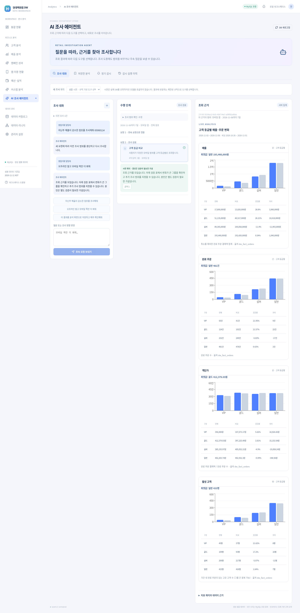

# AI 조사 에이전트

왼쪽 **AI 조사 에이전트**가 이전 **내 분석 앱** 메뉴와 생성 화면을 대체합니다. 이전에 저장한 앱·감시·실행 이력은 삭제하지 않고 새 화면의 저장한 분석·정기 감시·감시 실행 이력 탭에서 보여줍니다. 이전 #myapps 주소도 새 화면으로 연결됩니다.

## 영업기획 담당자의 사용 순서

1. **AI 조사 에이전트 → 조사 대화**로 들어갑니다.
2. **조사 모드**를 선택합니다. OpenAI API 키가 있으면 실제 AI 모드를 사용할 수 있습니다. 키가 없으면 명시적으로 표시한 샘플 시연 모드를 사용할 수 있습니다.
3. “지난주 매출이 감소한 점포를 조사하고 추가로 확인할 내용을 정리해줘.”라고 입력하고 **조사 시작**을 누릅니다.
4. 가운데 수행 단계에서 어떤 도구를 왜 선택했는지 확인합니다. 오른쪽에서 실제 DB 집계와 비교 기간을 확인합니다.
5. 조사 중 또는 완료 후 “오프라인 말고 모바일 쪽만 더 봐줘.”라고 입력하고 **후속 요청 보내기**를 누릅니다. 이전 요청과 조회 근거는 남고 새로운 요청으로 조사를 이어갑니다.
6. “이 결과를 분석 화면으로 저장하고 매주 확인해줘.”라고 요청합니다.
7. **저장·감시 초안 검토**를 누릅니다. 이름, 주기, 요일, 한국 시간, 임계값과 활성화 여부를 확인합니다.
8. **확인하고 분석·감시 저장**을 누르면 분석 화면과 감시가 함께 저장됩니다. 확인 전에는 생성되지 않습니다.
9. **저장한 분석**에서 결과를 다시 열고, **정기 감시**에서 시험 실행·일정 수정·활성화·중지를 관리합니다. **감시 실행 이력**에서 실제·시험·과거 재현 기록을 조회합니다.

조사를 멈추려면 **조사 잠시 멈춤**, 이어가려면 **조사 이어가기**를 사용합니다. 이전 대화는 **이전 조사**에서 열 수 있습니다. 기존 저장 데이터는 그대로 보존합니다.

## 실제 AI 모드와 샘플 시연

### 실제 AI 도구 선택

OpenAI Responses API의 구조화 응답을 이용해 매 단계 다음 행동 하나를 선택합니다. 모델에는 현재 요청·선택 범위·도구 설명·최근 메시지와 조회 근거를 전달합니다.

- 매출·주문·객단가·활성 고객 비교
- 고객 등급별 비교
- 앱 구매 전환율 비교
- 예산 집행률·목표 달성률 비교
- 데이터 카탈로그 확인

예를 들어 첫 조회에서 주문 수 감소가 크면 채널·고객 등급을, 객단가 변화가 크면 상품군을 추가 조사하도록 모델이 선택할 수 있습니다. 고정된 조회 순서를 서버가 수행하는 구조가 아닙니다. 각 도구 결과를 모델의 다음 호출에 전달합니다. 모델 응답은 서버가 검증한 뒤 허용된 조회 함수에만 전달합니다.

사용자 확인이 필요한 사항은 추가 질문으로 반환할 수 있습니다. 한 요청에서 조회 최대 6회, 판단 최대 8회, 한 대화에서 후속 요청 최대 20회입니다. 서버당 실제 모델 단계 동시 2건, 분당 12건이며 외부 호출당 최대 45초 제한입니다. 한도를 넘기면 안내 후 사용자가 이어갈 수 있습니다.

### 샘플 시연 · 규칙 기반 도구 선택

키 없이 시연하는 모드입니다. 실제 AI 모드로 표시하지 않습니다. 실제 DB를 조회하고 제한된 규칙으로 다음 도구를 선택합니다.

- 첫 조회에 감소 그룹이 있으면 채널 비교, 없으면 상품군 비교로 분기합니다.
- “모바일 쪽만” 요청은 모바일 고객 등급 집계를 조회합니다.
- 저장·주간 감시 요청은 기존 동일 범위의 조회 근거에서 초안을 만듭니다.

따라서 “실제 모델이 자율적으로 조사했다”는 시연은 아닙니다. 자유로운 업무 질문은 실제 AI 모드에서 사용해야 합니다. 자동 테스트의 모델 대역도 실제 모델의 추론 품질을 검증하지 않습니다.

## 대화 개입과 저장

대화·범위·각 단계·조회 근거·결론·저장 초안을 PostgreSQL의 investigation_sessions에 보관합니다. 기존 테이블을 비우지 않고 서버 시작 시 새 테이블을 추가합니다. 최신 50개 대화를 목록에 표시합니다.

브라우저는 단계 실행을 한 번씩 요청합니다. 이전 조회가 진행 중이어도 새 요청을 보낼 수 있습니다. 새 요청은 버전을 올리고 이전 호출의 취소를 요청합니다. 이전 응답이 늦게 도착하더라도 버전이 맞지 않으면 저장하거나 새 조사에 섞지 않습니다. 새 요청의 범위에 맞는 근거만 결론·저장 초안에서 참조할 수 있습니다.

모바일만 요청한 후속 조사는 서버에서도 해당 채널을 확인합니다. 고정된 도구를 반복 선택하면 중지하고 추가 요청을 안내합니다. 날짜와 기간·점포·채널도 서버가 검증합니다.

저장 확인은 하나의 PostgreSQL 트랜잭션에서 분석 화면·버전·감시·대화의 저장 상태를 함께 기록합니다. 같은 초안을 다시 승인해도 중복 생성하지 않습니다. 기본 감시는 비활성 상태입니다. 분석 화면은 **조사 기간을 고정한 결과 조회**이고, 정기 감시는 실행 시 정한 비교 기간을 다시 계산합니다. 기본값은 직전 완료 주 비교입니다.

## 숫자와 설명

모델이 숫자를 작성해서 차트를 그리지 않습니다. 검증 표·차트는 기존 완료 주문·결제·앱·예산 테이블의 서버 집계값입니다. 모델의 결론에는 실제 조회 근거 ID가 필요하고, 임의 숫자가 포함된 결론은 검증 오류로 중단합니다. 수치와 증감률은 근거 표에서 제공합니다.

자연어 설명은 AI의 해석 또는 가설입니다. 근거 ID가 있다는 것만으로 모든 자연어 주장의 정확성이나 인과 관계를 보장하지는 않습니다. 매출 감소 기여도와 실제 원인은 구분해야 합니다. 개인정보·SQL 실행·외부 작업 도구는 제공하지 않습니다. 고객 등급은 집계만 조회하며 고객 원본 행을 전달하지 않습니다.

데이터 보유 범위가 부족하면 빈 검증 결과와 판단 보류 근거를 제공합니다. 데이터 기준일은 샘플 DB 종료일입니다. 질문과 집계 근거는 실제 모드에서 OpenAI에 전송되며, store:false를 사용합니다.

기존 프로젝트처럼 인증 없는 공유 워크스페이스이며 사용자별 소유권은 아직 없습니다. 대화에서 개인정보를 입력하지 마세요. 공용 배포 시 인증/사용자 분리와 보관 정책을 추가해야 합니다. 스케줄러도 기존처럼 단일 API 인스턴스용입니다.

## API

| 메서드 | 경로 | 역할 |
| --- | --- | --- |
| GET | /api/investigations/meta | 준비 상태와 도구·데이터 정보 |
| GET / POST | /api/investigations | 대화 목록 / 새 조사 |
| GET | /api/investigations/:id | 메시지·단계·근거·초안 |
| POST | /api/investigations/:id/messages | 후속 요청 / 진행 중 개입 |
| POST | /api/investigations/:id/step | 다음 도구 선택·실행 또는 완료 |
| POST | /api/investigations/:id/pause | 일시 중지 / 재개 |
| POST | /api/investigations/:id/approve | 검토한 분석·감시 저장 |

변경 요청에는 대화 version을 사용합니다. 다른 사이트의 변경 요청은 기존 API와 같은 Origin 검사를 거칩니다. 입력은 3~1,000자입니다. 서버는 임의 SQL/코드를 실행하지 않습니다.

## 검증

- 일반 테스트와 실제 PostgreSQL에서 결과에 따른 도구 분기, 이전 관찰 전달, 모바일 등급 집계, 버전 충돌, 느린 응답 폐기, 중지·재개를 검사합니다.
- 허용되지 않은 도구, 반복 조회, 잘못된 범위·근거 ID·숫자 결론을 검사합니다.
- 사용자 승인 전 미저장, 승인 시 원자 저장, 반복 승인 중복 방지를 검사합니다.
- 고객 등급 감시의 상품군/채널 추가 조회도 해당 등급으로 한정되는지 확인합니다.
- Chromium은 진행 중 후속 개입, 모바일 조사, 새로고침 후 대화 열기, 초안 검토, 저장, 감시 시험 실행, 모바일 화면을 실제 API/PostgreSQL로 검사합니다.
- 실제 OpenAI 호출은 테스트 키가 없어 수행하지 않았습니다. 도구 선택 프로토콜은 모델 대역으로, 브라우저는 명시적 샘플 시연 모드로 검증합니다.

    npm test
    npm run test:pg
    npm run build
    CHROME_BINARY=/usr/bin/chromium python3 tests/investigation_browser_smoke.py

## 화면

