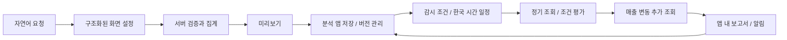
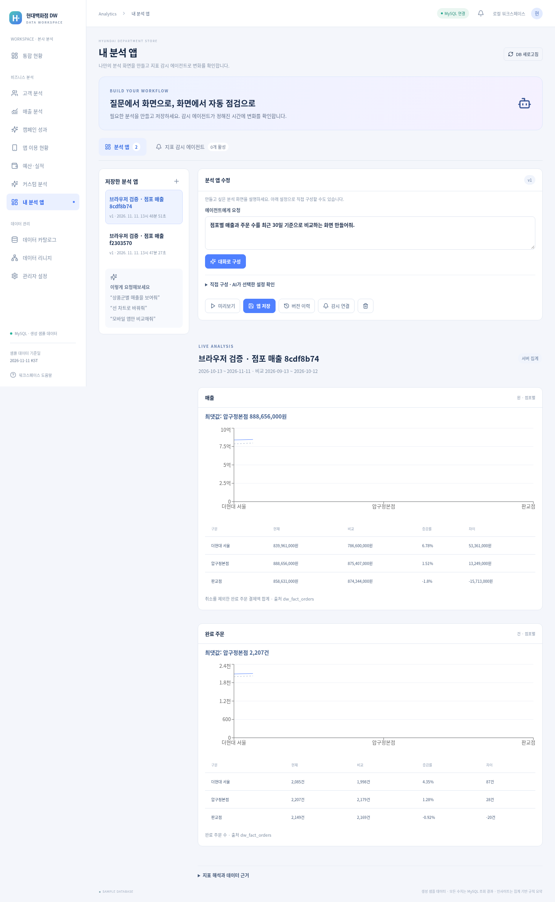
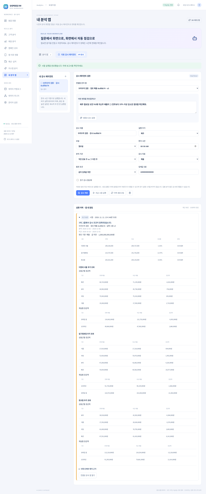

> 최신 버전에서는 왼쪽 **AI 조사 에이전트**로 이동합니다. 기존 앱과 이력은 새 화면에 보존됩니다. [현재 사용법](investigation-agent.md)

# 내 분석 앱과 지표 감시 에이전트

## 사용 흐름

왼쪽 **내 분석 앱** 메뉴에서 분석 앱과 지표 감시 에이전트 탭을 사용할 수 있습니다.

1. **대화로 구성**에 필요한 분석을 설명합니다. 예: “최근 30일 점포별 매출과 주문 수를 막대 차트로 비교해줘.”
2. AI가 제안한 지표·기간·점포·채널·차트를 확인합니다. 후속 요청은 현재 초안을 함께 전달하므로 “선 차트로 바꿔줘”처럼 수정할 수 있습니다.
3. 직접 구성에서 설정을 조정하고 **미리보기**로 서버 집계값을 확인합니다.
4. **앱 저장**을 누르면 PostgreSQL에 저장됩니다. 저장 목록에서 다시 열면 최신 DB 종료일을 기준으로 재조회합니다.
5. **버전 이력 → 초안으로 복원 → 앱 저장**으로 이전 구성을 새 버전으로 복원합니다. 과거 버전을 덮어쓰지 않습니다.
6. 저장된 앱에서 **감시 연결**을 선택하고 대화 또는 직접 설정으로 감시 업무를 구성합니다.
7. 비활성 상태로 **감시 저장 → 지금 시험 실행**해 보고서를 검토한 뒤 정기 감시를 활성화합니다.
8. 실행 이력에서 판정·비교 기간·근거 표·매출 추가 조회·실행 시점 앱 버전을 확인합니다.



## 지원 범위

| 항목 | 지원 |
| --- | --- |
| 지표 | 매출, 완료 주문, 객단가, 활성 고객, 앱 구매 전환율, 예산 집행률, 매출 목표 달성률 |
| 분석 축 | 점포별, 채널별, 상품군별, 일별 |
| 상품군별 지표 | 매출, 완료 주문, 객단가 |
| 기간 | DB 최신 데이터일 종료 최근 1~90일 |
| 비교 | 직전 동일 일수, 전년 동기 |
| 필터 | 점포, 채널 |
| 표현 | 막대 차트+표, 선 차트+표, 표 |
| 정기 실행 | 매일 또는 매주 지정 요일 / HH:mm / Asia/Seoul |
| 감시 기간 | 어제 종료 앱 기간, 또는 직전 완료 월~일(7일) |
| 감시 축 | 점포별, 채널별, 상품군별 (일별 앱 제외) |
| 조건 | 상대 감소율 이상, 지표값 미만, 지표값 초과 |
| 알림 | 내 분석 앱 내부 실행 이력. 이메일·Slack 등 외부 발송은 포함하지 않음 |

한 앱에서 1~4개 지표를 선택할 수 있습니다. 단위가 다른 지표는 별도 차트로 표시합니다. 필터의 점포는 DB에 실제 존재하는 ID인지 검사합니다. 사용자 코드나 SQL을 생성·실행하지 않습니다. 지원하지 않는 요청은 AI의 `supported=false` 또는 서버 설정 검증에서 거부합니다. 고정 날짜·자유 SQL·외부 업무는 현재 지원하지 않습니다.

### 지표 정의

- 매출: 취소 제외 완료 주문의 결제액 합계.
- 완료 주문: 고유 완료 주문 수. 상품군별 주문은 해당 상품군이 포함된 주문이므로 그룹 간 중복될 수 있습니다.
- 객단가: 해당 그룹 매출 / 해당 그룹 고유 완료 주문 수.
- 활성 고객: 기간 내 완료 주문이 있는 고유 고객. 점포·채널 간 합산하면 중복될 수 있습니다.
- 앱 구매 전환율: 구매 주문이 연결된 세션 / 전체 세션 × 100.
- 예산 집행률: 집행액 / 배정 예산 × 100.
- 목표 달성률: 완료 주문 매출 / 기간 배정 매출 목표 × 100.
- 비율 지표의 증감률은 상대 변화율(%), 차이는 퍼센트포인트(%p). 분모가 0이면 계산 불가로 표시합니다.
- 전년 2월 29일은 이전 해 2월 28일로 대응합니다. 윤일 경계의 일별 비교는 대응 날짜가 겹칠 수 있습니다.

## 감시의 동작

예: “매주 월요일 09:00에 지난주 매출이 그 이전 주보다 10% 이상 감소한 점포를 확인해줘.”

1. 저장된 앱의 **실행 당시 최신 버전**을 읽습니다. 설정 변경 시 연결된 감시가 사용할 수 없는 지표/분석 축으로 바꾸는 것은 막습니다. 먼저 연결 감시를 수정하거나 삭제해야 합니다.
2. 한국 날짜 기준 직전 완료 월요일~일요일과 그 이전 주를 결정합니다. rolling은 한국 날짜 어제까지 앱의 최근 N일과 비교 기준을 적용합니다.
3. 두 기간이 데이터 보유 범위에 완전히 들어오는지 확인합니다. 앱·예산 지표는 운영 이력 시작일도 확인합니다.
4. 서버가 그룹별 현재값·비교값·증감률을 계산합니다.
5. `drop`: 증감률 ≤ -임계값. `below`: 현재값 < 임계값. `above`: 현재값 > 임계값. 임계값과 같은 값의 포함 여부가 다릅니다.
6. **매출 지표에서 조건이 발견되면** 해당 그룹의 상품군·채널별 증감액을 추가 조회합니다. 점포·채널 필터를 유지하고 상품군 감시는 해당 상품군에 한정합니다. 그룹 최대 10개를 조사합니다. 다른 지표는 현재/비교 근거 표를 제공합니다.
7. 실행 당시 앱 설정·버전·감시 조건·분석 기간·집계 근거를 보고서에 보관합니다. 보고서 숫자는 LLM이 생성하지 않습니다.

| 상태 | 의미 |
| --- | --- |
| 실행 중 | 실행을 DB에 등록하고 집계 중 |
| 조건 발견 | 하나 이상의 그룹에서 조건 충족 |
| 정상 | 평가 가능한 모든 그룹에서 조건 불충족 |
| 판단 보류 | 보유 기간 부족, 데이터 없음, 상대 증감률 기준값 0 등 |
| 실행 실패 | 집계 실행 실패 또는 서버 재시작으로 중단 |

판단 가능한 그룹에서 조건이 발견되면 조건 발견을 우선 표시합니다. 같은 보고서에 판단 불가 그룹은 보류로 표시합니다. 데이터 보유 기간 전체가 부족하면 전체 판단을 보류합니다. 감소 기여도는 관측값의 분해이며 행사 종료·경쟁사·날씨 등의 원인이나 인과 효과를 입증하지 않습니다.

### 일정과 복구

- API 서버에 내장된 스케줄러가 30초마다 실행 대상을 확인합니다. 저장 후 다음 실행일은 설정 시각보다 엄격히 미래인 첫 일정입니다.
- 시험 실행은 비활성 감시에서도 가능하며 정기 실행 시각을 바꾸지 않습니다. 화면에서 수정한 감시 설정은 먼저 저장해야 합니다.
- 활성화/설정 변경 시 다음 일정이 새로 계산됩니다. 비활성화한 감시는 자동 실행하지 않습니다.
- `(agent_id, slot)` 고유 제약과 트랜잭션으로 같은 예정 시각의 중복 등록을 차단합니다. PostgreSQL의 감시 행 잠금(`SELECT … FOR UPDATE`)으로 동시 실행 등록을 직렬화합니다.
- 서버가 중단된 동안 놓친 일정을 재시작 후 한 번 처리하고 다음 미래 일정으로 이동합니다. 누락된 모든 회차를 재생하지 않습니다.
- 재시작 시 실행 중이던 기록은 실패로 마감합니다. **이 스케줄러는 API 서버 단일 인스턴스용**입니다. 여러 인스턴스 운영에는 분산 lease/독립 워커와 별도 복구 절차가 필요합니다.
- 최근 50건을 화면에 표시합니다. 이전 이력은 DB에 남습니다. 장기 운영 시 보관 기간 정책을 추가하세요.
- 앱 삭제 시 연결 감시·버전·실행 이력을 함께 삭제합니다. 실행 중 삭제는 거부합니다.

## AI와 데이터 흐름

`OPENAI_API_KEY`가 있으면 Responses API 구조화 응답(`store:false`)으로 화면 설정 또는 감시 설정을 만듭니다. 제공되는 정보는 사용자 요청, 현재 설정, 지표 정의와 점포 목록이며 원본 고객 행은 전송하지 않습니다. 생성된 설정은 서버가 다시 검증합니다. 호출은 화면·감시 설정이 공유하는 서버당 동시 1건/분당 6건 제한과 호출당 45초 제한을 적용합니다.

키가 없으면 AI 버튼이 비활성화되며 직접 구성·미리보기·저장·감시·시험/정기 실행은 모두 사용할 수 있습니다. 정기 보고서는 서버의 조건 평가와 집계 근거로 작성하며 API 비용이 발생하지 않습니다.

현재 기존 프로젝트와 같이 사용자 인증 없이 공유 워크스페이스로 동작합니다. 공용 서비스로 배포하려면 사용자 인증, 앱/감시 소유권, 사용자별 한도 제어를 연결해야 합니다. 기존 `settings.alertsEnabled`와 별개로 각 감시의 활성화 여부를 사용합니다. 역방향 프록시의 실제 서비스 origin이 API host와 다르면 서버 환경 변수 `APP_ORIGIN=https://서비스주소`를 설정하세요.

## 저장 구조와 API

PostgreSQL 초기화 후 다음 테이블을 `CREATE TABLE IF NOT EXISTS`로 추가합니다. 기존 거래 데이터를 삭제하거나 재생성하지 않습니다.

- `analysis_apps`: 현재 앱 설정과 버전.
- `analysis_app_versions`: 버전별 구성·사용자 요청·시각.
- `metric_agents`: 연결 앱·조건·활성화 여부·다음 실행일.
- `metric_agent_runs`: 예정 슬롯·상태·실행 시점 설정과 보고서.

| 메서드 | 경로 | 역할 |
| --- | --- | --- |
| GET | `/api/my-apps/meta` | 지원 지표·분석 축·AI 준비 여부 |
| POST | `/api/my-apps/plan` | 자연어 → 검증된 화면 설정 |
| POST | `/api/my-apps/preview` | 초안 집계 |
| GET / POST | `/api/my-apps` | 목록 / 생성 |
| GET / PUT / DELETE | `/api/my-apps/:id` | 조회 / 버전 확인 후 수정 / 삭제 |
| GET | `/api/my-apps/:id/data` | 저장된 앱의 최신 데이터 |
| GET | `/api/my-apps/:id/versions` | 버전 이력 |
| POST | `/api/metric-agents/plan` | 자연어 → 검증된 감시 설정 |
| GET / POST | `/api/metric-agents` | 목록 / 생성 |
| GET / PUT / DELETE | `/api/metric-agents/:id` | 조회 / 수정·활성화 / 삭제 |
| POST | `/api/metric-agents/:id/test` | 저장된 설정으로 시험 실행 |
| GET | `/api/metric-agents/:id/runs` | 최근 50개 실행 보고서 |

설정 저장의 `version`이 현재 버전과 다르면 HTTP 409를 반환합니다. UI는 앱을 다시 열어 변경을 확인하도록 안내합니다. 변경 요청은 다른 사이트의 Origin/Sec-Fetch-Site 요청을 거부하며, 요청 본문은 16KB로 제한합니다.

## 개발 검증

```bash
npm ci
npm test
npm run test:pg
npm run build
npm start
```

`tests/workspace.test.mjs`를 격리 SQLite 픽스처와 실제 PostgreSQL에서 동일하게 실행합니다. 지표 원본 대조, 모든 분석 축, 필터, 전년 비교, 설정 검증, LLM 대역, 버전 충돌/복원, KST 일정 경계, 0 분모, 조건 경계, 추가 조회, 보유 기간 부족, 중복 정기 실행, HTTP 및 삭제 연쇄를 검사합니다. 실제 OpenAI 유료 호출은 대역과 별도로 확인해야 합니다.

### 실제 Chromium 브라우저 검증

재현 가능한 브라우저 시나리오는 `tests/browser_smoke.py`에 있습니다. Python Playwright와 Chromium이 설치된 환경에서 서버를 실행한 뒤 아래처럼 실행합니다. `CHROME_BINARY`는 실제 설치된 Chromium/Chrome 경로로 지정하세요.

```bash
CHROME_BINARY=/usr/bin/chromium DW_BROWSER_URL=http://127.0.0.1:3001 python3 tests/browser_smoke.py
```

AI 계획 응답만 브라우저에서 대역 처리하고, 실제 API와 PostgreSQL로 미리보기·저장·수정·버전 복원·감시 생성·시험 실행·활성화/중지·재조회·삭제를 검사합니다. 화면 캡처는 Git에서 제외한 `work/`에 저장합니다. 서버 테스트의 LLM 대역과 함께 유료 API 호출 없이 실행할 수 있습니다. 테스트용 앱·감시는 성공 시 삭제합니다. 중간 실패 시 `브라우저 검증`으로 시작하는 테스트 항목이 남을 수 있습니다.

### 이번 구현의 검증 결과

Node.js 24, MySQL 8.4, 실제 Chromium에서 확인했습니다.

- `npm test`: 35개 통과.
- `npm run test:mysql`: 실제 MySQL 15개 통과.
- `npm run build`: TypeScript 검사와 프로덕션 빌드 통과.
- `python3 tests/browser_smoke.py`: 대화 생성/후속 수정 UI(모델 대역), 감시 대화 구성 UI(모델 대역), 저장/복원/시험/활성화/중지/삭제 통과. 브라우저 런타임 오류 0건.
- 모바일 390px에서 페이지 가로 넘침 없음.
- 실제 OpenAI 유료 호출은 API 키가 없어 수행하지 않았습니다.

## 화면 예시

생성 샘플 MySQL 데이터를 사용한 브라우저 검증 화면입니다. 감시 화면은 조건 발견과 추가 조회를 검증하기 위해 큰 임계값을 의도적으로 설정한 예시이며 실제 이상 징후를 의미하지 않습니다.

### 저장한 분석 앱



### 감시 설정과 실행 보고서


