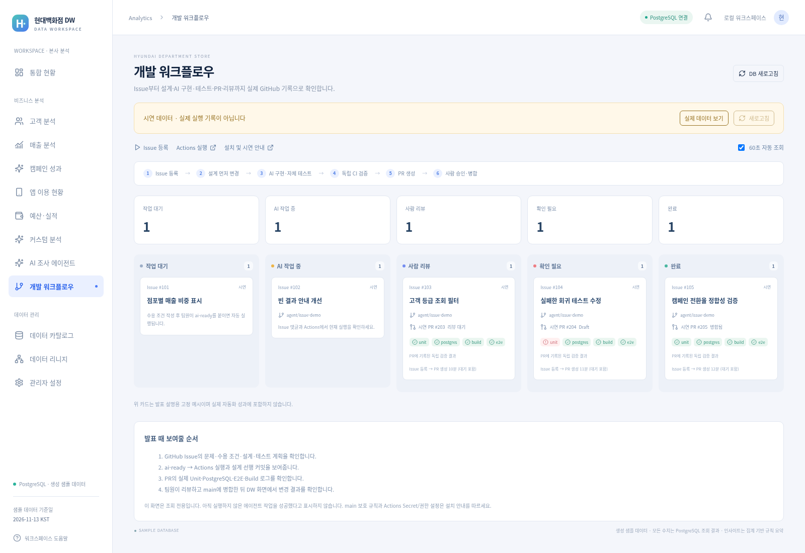

# 3주차 발표 진행안 (7~10분)

## 화면 구성

GitHub Issue / Actions / PR / DW의 개발 워크플로우 메뉴를 탭으로 준비합니다. 작업 보드는 실제 GitHub 데이터를 사용합니다. 전체 흐름을 설명할 때만 명시적 시연 모드를 켜고 “고정 예시”임을 말합니다.

## 시연 순서

1. 실제 Issue의 Problem / Acceptance criteria / Design / Tests를 설명한다.
2. 팀원이 ai-ready 라벨을 붙여 Actions가 자동 시작되는 장면을 보여준다.
3. agent/issue-N-run 브랜치와 설계 커밋이 코드 커밋보다 먼저 있는 것을 확인한다.
4. Unit/PostgreSQL/Build/E2E 결과와 실제 종료 코드/로그를 보여준다.
5. PR의 연결 Issue, 테스트 표, Draft/일반 상태를 확인한다.
6. 팀원이 리뷰하고 main 보호 규칙이 승인을 요구하는 것을 보여준다.
7. 병합 후 git pull → DW 화면에서 변경한 기능을 확인한다.

실시간 모델 실행은 길어질 수 있으므로 초반에 시작하고 중간에는 사전에 완료한 실제 Issue/PR을 설명합니다. 사전 실행 기록과 실시간 기록을 혼동시키지 않습니다. 실패 사례는 실제 실패 로그와 Draft PR을 보여줍니다. 오류를 숨기거나 예상 결과를 실제 실행처럼 시연하지 않습니다.

## 작은 실제 시연 Issue 예시

제목: 매출 분석 점포별 실적에 매출 비중 열 추가

### Problem

점포 매출액만으로 전체 기여를 비교하기 어렵다.

### Acceptance criteria

- 선택 기간/채널 내 점포 매출 / 전체 매출 × 100을 표시한다.
- 매출이 0이면 비중은 —로 표시한다.
- 기존 매출/주문 표시 및 필터를 유지한다.
- Unit 및 E2E로 비중과 빈 결과를 검증한다.

### Design

src/AnalysisPages.tsx의 점포 실적 테이블과 기존 API 결과를 사용한다. 새 DB 테이블/패키지는 필요 없다.

### Tests

Unit: 합계/0 분모. E2E: 필터 조회 후 비중 열과 값 확인.

## 발표용 성과 표

| Issue     | 실제 PR 링크 | 최초 결과 | 수정 횟수 | 실행 시간    | 사람 개입      |
| --------- | ------------ | --------- | --------- | ------------ | -------------- |
| 실제 번호 | 실제 링크    | 로그 기준 | 실제 횟수 | Actions 기준 | 실제 리뷰 내용 |

표는 실행한 작업으로만 채웁니다. 보드의 Issue→PR 시간은 대기 포함이므로 “AI 실행 시간”과 구분하세요. 자동화 전 시간을 측정하지 않았다면 절감률을 만들어 발표하지 않습니다.

## 작업 보드 화면 예시

아래 이미지는 **고정 시연 모드**입니다. 실제 Codex 성공 기록이 아닙니다. 실제 시연에서는 GitHub 조회 모드의 Issue/PR/Actions 링크를 사용하세요.

